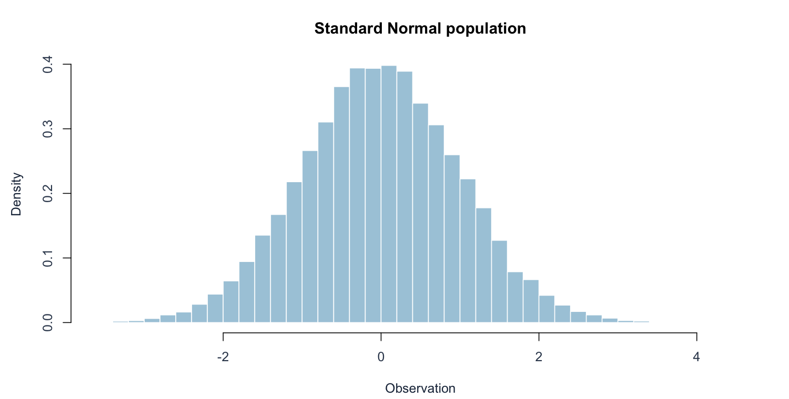
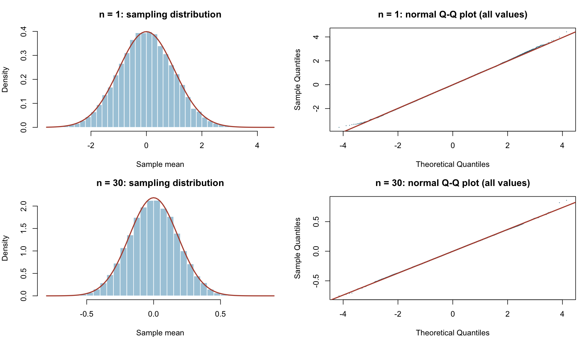
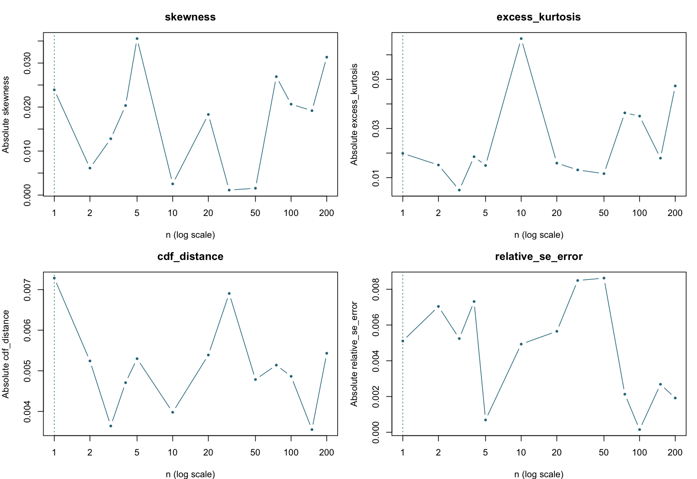

[Executive summary](../index.html) · [Full R implementation](../R/simulation.R)

```{r}
#| include: false
source("R/report_helpers.R")
key <- "normal"
result <- result_for(key)
if (!is.na(result$chosen)) {
  chosen <- row_at(result, result$chosen)
  previous <- row_at(result, max(1, result$chosen-1))
}
```

## Population, theory, and prediction

Observations are independent draws from $N(0,1)$. The population is already symmetric and bell-shaped, with $\mu=0$ and $\sigma=1$. For every positive integer n, the sample mean is **exactly** $N(0,1/n)$; no large-sample approximation is necessary.

The pre-simulation prediction is therefore n=1. The simulated mean should be close to 0, and the standard deviation of the 30,000 means should be close to $1/\sqrt n$. Small departures in Q–Q plots are expected from finite Monte Carlo sampling.

## Original population





## Results and graphical evidence

The actual sample sizes tested were:

```{r}
#| echo: false
cat(paste(result$diagnostics$n, collapse = ", "))
```

```{r}
#| echo: false
#| results: asis
decision_table(result)
```

The table shows the decision neighborhood and comparison sizes; the full numerical record is in `results/normal.csv`.





## Conclusion and limitations

The selected value is **n = `r result$chosen`**, agreeing with the exact normal sampling distribution. At this value the empirical mean is `r fmt(chosen$simulated_mean)`, the empirical SE is `r fmt(chosen$simulated_se)`, and the theoretical SE is `r fmt(chosen$theoretical_se)`. The observed skewness is `r fmt(chosen$skewness)` and excess kurtosis is `r fmt(chosen$excess_kurtosis)`.

The histogram matches the theoretical normal curve, and the Q–Q points closely follow the reference line. This is an exact-distribution benchmark for the simulation pipeline: requiring 30 observations here would impose an unnecessary rule.

A noteworthy result is that even this exactly normal case has nonzero simulated skewness and kurtosis. The generated data do not become “incorrect” because those diagnostics are not exactly zero. The normal model is exact; its empirical diagnostics are estimated with error.

## Reproduction

Run `Rscript run_simulations.R` and `Rscript validate.R` from the project root, then `quarto render`. Software versions are recorded in `results/session-info.txt`.
