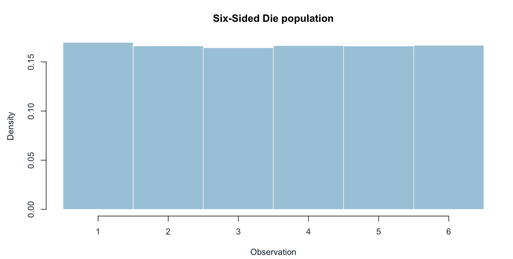
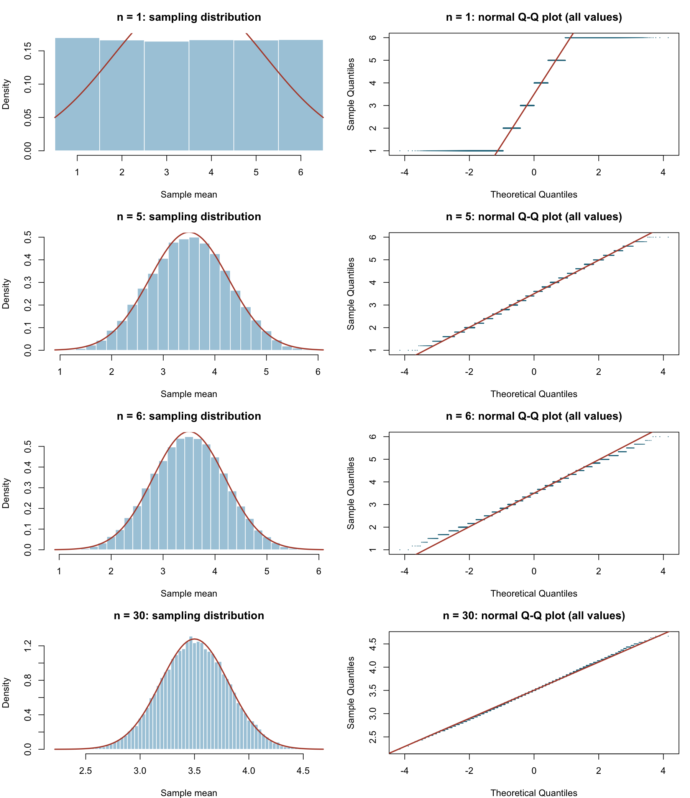
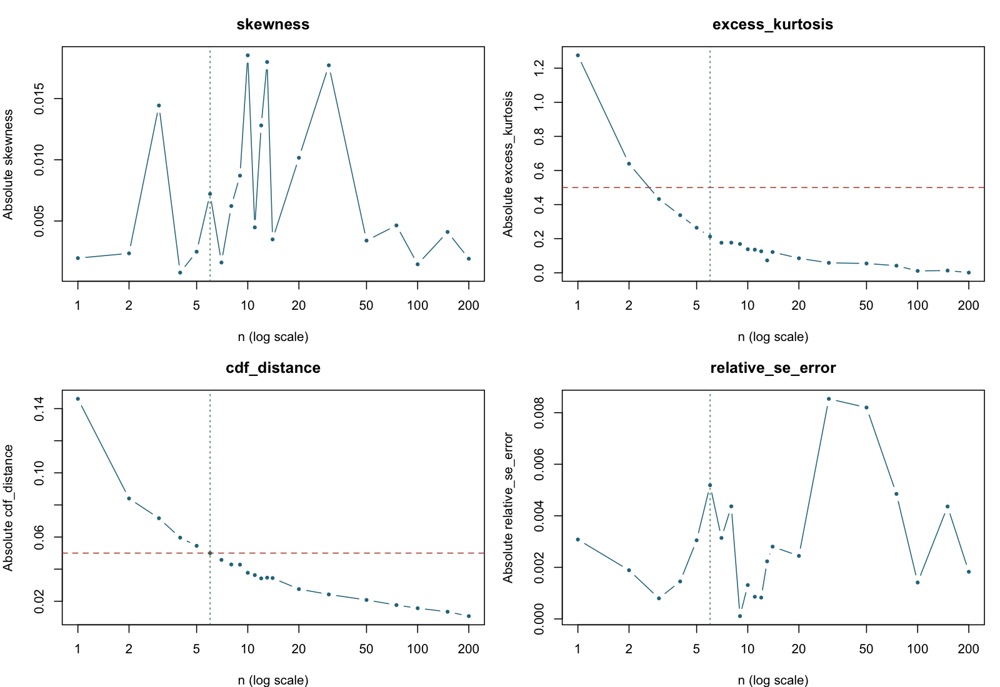

[Executive summary](../index.html) · [Full R implementation](../R/simulation.R)

```{r}
#| include: false
source("R/report_helpers.R")
key <- "die"
result <- result_for(key)
if (!is.na(result$chosen)) {
  chosen <- row_at(result, result$chosen)
  previous <- row_at(result, max(1, result$chosen-1))
}
```

## Population, theory, and prediction

Each observation is an independent fair die roll, taking values 1 through 6. The population is symmetric, bounded, and discrete, but not normal. Its mean is $\mu=3.5$ and variance is $\sigma^2=35/12$, giving $\sigma\approx1.7078$ and $\operatorname{SE}(\bar X)=\sqrt{35/(12n)}$.

The pre-simulation prediction is relatively rapid improvement because the original distribution has no skewness or heavy tails. Its theoretical excess kurtosis is $-222/175\approx-1.2686$; the sample mean has excess kurtosis $-222/(175n)$. Thus, having skewness near zero is not sufficient to establish normality at n=1.

## Original population





## Results and graphical evidence

The actual sample sizes tested were:

```{r}
#| echo: false
cat(paste(result$diagnostics$n, collapse = ", "))
```

```{r}
#| echo: false
#| results: asis
decision_table(result)
```

The table shows the decision neighborhood and comparison sizes; the full numerical record is in `results/die.csv`.





## Conclusion and limitations

The selected value is **n = `r result$chosen`** under the declared rule. At n=`r result$chosen-1`, the CDF discrepancy is `r fmt(previous$cdf_distance, 6)`, above 0.05. At n=`r result$chosen`, it falls to `r fmt(chosen$cdf_distance, 6)` and all four numerical criteria pass; the next four sample sizes pass as well. The empirical mean is `r fmt(chosen$simulated_mean)` versus 3.5, and empirical SE is `r fmt(chosen$simulated_se)` versus `r fmt(chosen$theoretical_se)`.

The chosen histogram has a central bell shape, while the Q–Q plot retains short horizontal steps because averages of integer rolls lie on a lattice. Those steps and bounded tails are real differences from a continuous normal distribution. This choice accepts them for a moderate global CDF approximation, not for exact point probabilities or extreme tails.

The borderline CDF distance is especially important: it is only slightly below 0.05. A new seed or tighter tolerance could choose a larger n. The interesting contrast is that symmetry is present at n=1, but the uniform histogram and strongly stepped Q–Q plot clearly fail normality. Symmetry alone would give the wrong answer.

## Reproduction

Run `Rscript run_simulations.R` and `Rscript validate.R` from the project root, then `quarto render`. Software versions are recorded in `results/session-info.txt`.
