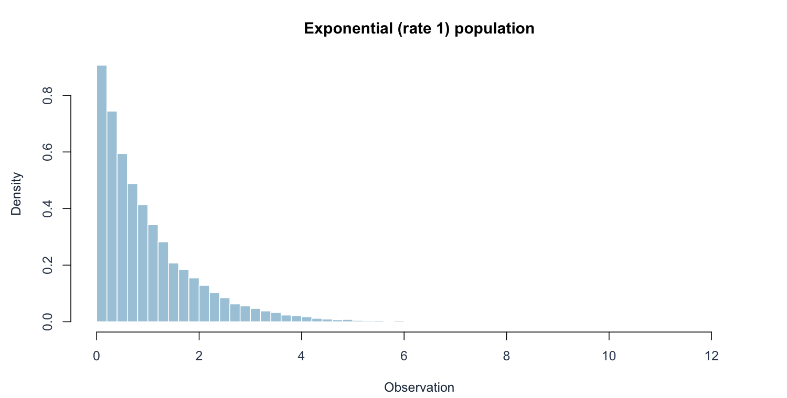
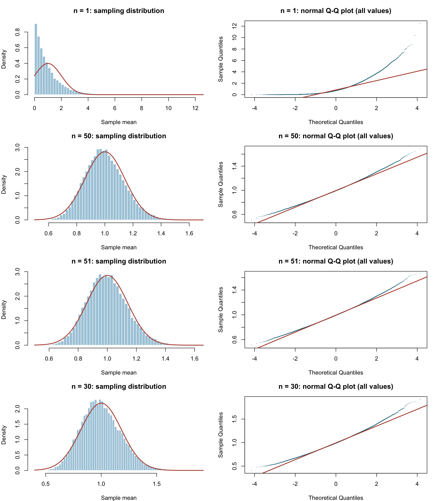
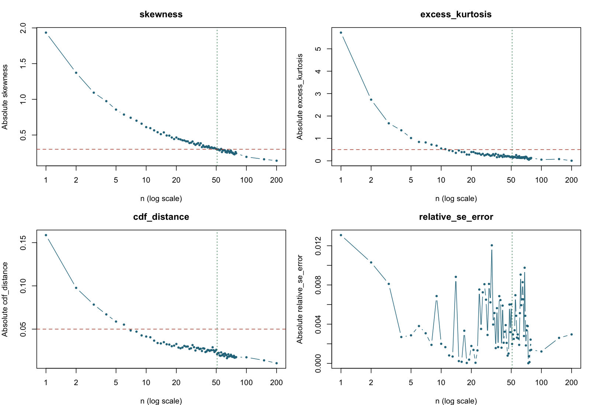

[Executive summary](../index.html) · [Full R implementation](../R/simulation.R)

```{r}
#| include: false
source("R/report_helpers.R")
key <- "exponential"
result <- result_for(key)
if (!is.na(result$chosen)) {
  chosen <- row_at(result, result$chosen)
  previous <- row_at(result, max(1, result$chosen-1))
}
```

## Population, theory, and prediction

Observations are independent exponential waiting times with rate $\lambda=1$. The population has $\mu=1$, $\sigma=1$, skewness 2, and excess kurtosis 6. It is strongly right-skewed, but its variance is finite.

The pre-simulation prediction is slower convergence than for the fair die. The exact sample-mean distribution is Gamma(shape=n, rate=n), with mean 1, SE $1/\sqrt n$, skewness $2/\sqrt n$, and excess kurtosis $6/n$. These theoretical identities provide checks on the observed trend. For example, the theoretical skewness is about 0.365 at n=30 and first becomes at most 0.30 at n=45. A noisy empirical cutoff need not equal 45.

## Original population





## Results and graphical evidence

The actual sample sizes tested were:

```{r}
#| echo: false
cat(paste(result$diagnostics$n, collapse = ", "))
```

```{r}
#| echo: false
#| results: asis
decision_table(result)
```

The table shows the decision neighborhood and comparison sizes; the full numerical record is in `results/exponential.csv`.





## Conclusion and limitations

The primary run selects **n = `r result$chosen`**. At n=`r result$chosen-1`, the skewness is `r fmt(previous$skewness)`, above 0.30; at the chosen n it is `r fmt(chosen$skewness)`. The empirical mean is `r fmt(chosen$simulated_mean)` versus 1. The empirical and theoretical SEs are `r fmt(chosen$simulated_se)` and `r fmt(chosen$theoretical_se)`, respectively.

The histogram has become approximately bell-shaped, but the full Q–Q plot still bends in the tails. Calling this “normal enough” is a decision about moderate approximation accuracy, not a claim that the gamma distribution has become exactly normal. At n=30 the observed skewness is `r fmt(row_at(result,30)$skewness)`, so the predeclared criterion fails.

## Reproducibility and a second seed

```{r}
alt <- experiments$alternate
rows <- do.call(rbind, lapply(c(30, 39, 51), function(n) {
  rbind(row_at(result,n), row_at(alt,n))
}))
show_table(rows[,c("seed","n","skewness","excess_kurtosis","cdf_distance","pass")])
```

Running the same code again with seed 5533 reproduces the stored n=30 means exactly (verified in `validate.R`). The separate experiment with seed **5534** repeats the same coarse search, integer refinement, B, and tolerances. It selects **n = `r alt$chosen`**, compared with **`r result$chosen`** in the primary run. No seed was substituted to obtain a preferred result.

This difference is the most informative unexpected feature of this experiment. The exact minimum selected by a threshold rule is unstable near its boundary, even after requiring five consecutive passing n. The normal-model approximation to the Monte Carlo SE of estimated skewness is $\sqrt{6/B}\approx0.0141$; this is only an order-of-magnitude guide for a non-normal distribution. Reusing the seed also correlates neighboring experiments, so five passes are not five independent confirmations.

The broad scientific conclusion is unchanged: skewness decreases with n, n=30 fails this standard in both runs, and the finite-variance CLT applies. The precise selected n is not a population constant. A more conservative application would increase n or B and recheck the diagnostics rather than treat 51 as a sharp mathematical boundary.

## Reproduction

Run `Rscript run_simulations.R` and `Rscript validate.R` from the project root, then `quarto render`. Software versions are recorded in `results/session-info.txt`.
