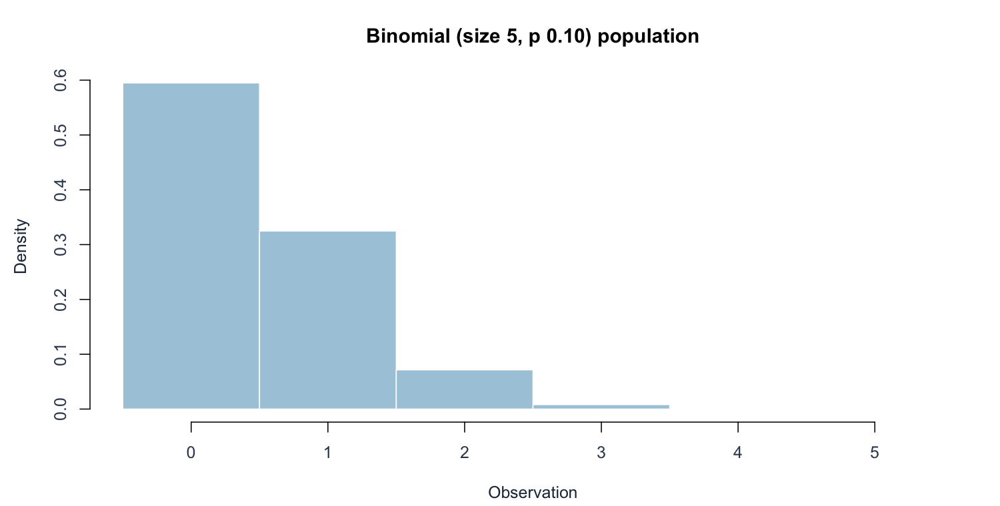
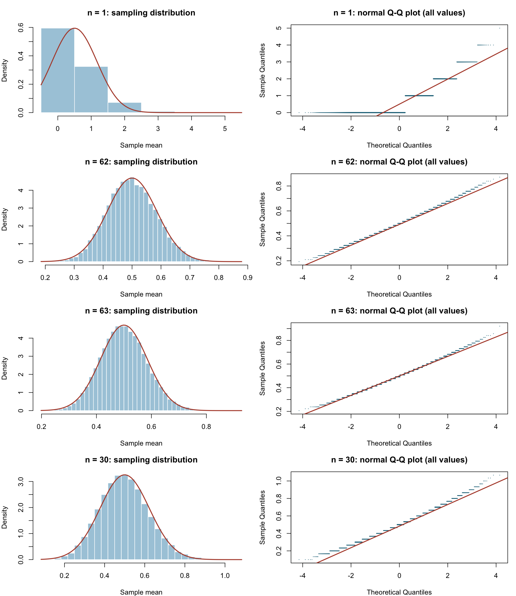
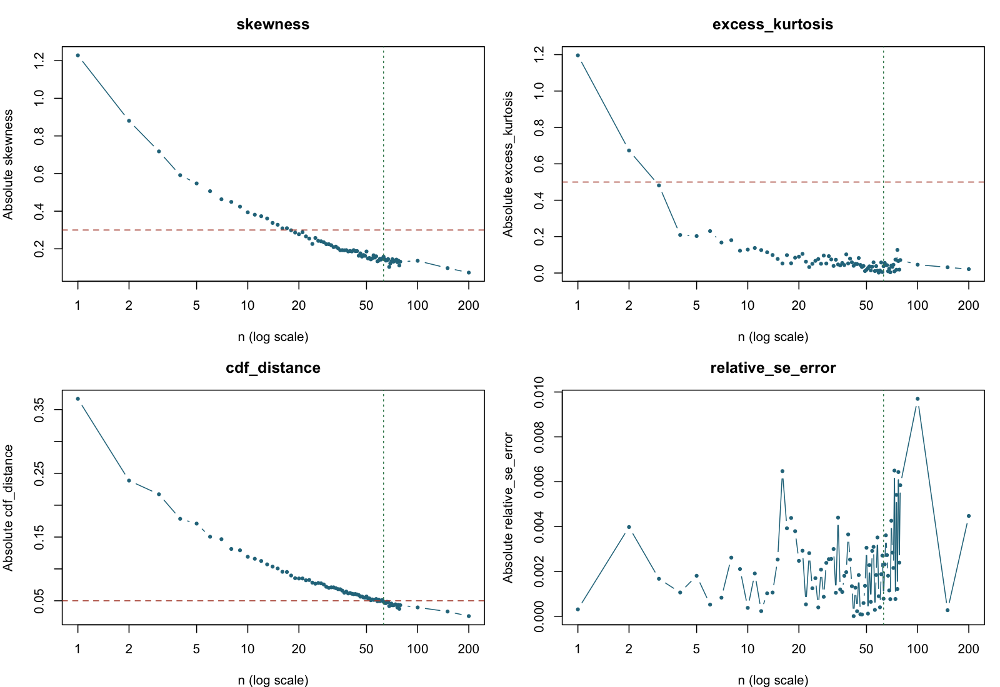

[Executive summary](../index.html) · [Full R implementation](../R/simulation.R)

```{r}
#| include: false
source("R/report_helpers.R")
key <- "binomial"
result <- result_for(key)
if (!is.na(result$chosen)) {
  chosen <- row_at(result, result$chosen)
  previous <- row_at(result, max(1, result$chosen-1))
}
```

## Population, theory, and prediction

Each observation is a count $X\sim\operatorname{Binomial}(5,0.10)$, taking values 0 through 5. The **5 is the number of trials within one observation**. The project sample size n is the number of independent such counts averaged in one Monte Carlo repetition; these are different quantities.

Here $\mu=5(0.1)=0.5$ and $\sigma^2=5(0.1)(0.9)=0.45$, so $\sigma=\sqrt{0.45}\approx0.6708$ and $\operatorname{SE}(\bar X)=\sqrt{0.45/n}$. The original population is right-skewed and highly discrete: $P(X=0)=0.9^5=0.59049$.

The pre-simulation prediction is slower convergence than for the die because both asymmetry and visible probability jumps matter. Since $n\bar X\sim\operatorname{Binomial}(5n,0.10)$, the theoretical skewness is $0.8/\sqrt{0.45n}$ and excess kurtosis is $0.46/(0.45n)$. The lattice spacing of the mean is $1/n$; it never becomes a continuous distribution at finite n.

## Original population





## Results and graphical evidence

The actual sample sizes tested were:

```{r}
#| echo: false
cat(paste(result$diagnostics$n, collapse = ", "))
```

```{r}
#| echo: false
#| results: asis
decision_table(result)
```

The table shows the decision neighborhood and comparison sizes; the full numerical record is in `results/binomial.csv`.





## Conclusion and limitations

The selected value is **n = `r result$chosen`**. The empirical mean is `r fmt(chosen$simulated_mean)` versus 0.5, and empirical SE is `r fmt(chosen$simulated_se)` versus the theoretical `r fmt(chosen$theoretical_se)`. At n=`r result$chosen-1`, the CDF discrepancy is `r fmt(previous$cdf_distance)`, compared with `r fmt(chosen$cdf_distance)` at the selected n.

The histogram becomes bell-shaped and the central Q–Q pattern approaches a straight line. Horizontal Q–Q steps persist. At n=30, skewness is `r fmt(row_at(result,30)$skewness)`, already below 0.30, but CDF distance is `r fmt(row_at(result,30)$cdf_distance)`, above 0.05. Therefore n=30 fails the combined rule even though a skewness-only rule might accept it.

The noteworthy result is that this population needs a larger selected n than the exponential case under the chosen criteria. That does not establish an intrinsic ranking for every meaning of “normal enough”: here the uncorrected CDF criterion is sensitive to discrete jumps, whereas exponential convergence is chiefly limited by skewness. A continuity-corrected approximation to count probabilities could produce a different practical recommendation.

The candidate remains an empirical boundary, subject to seed and tolerance choices. It is not a claim that exact normality occurs at this n or that every later simulated diagnostic must improve monotonically.

## Reproduction

Run `Rscript run_simulations.R` and `Rscript validate.R` from the project root, then `quarto render`. Software versions are recorded in `results/session-info.txt`.
