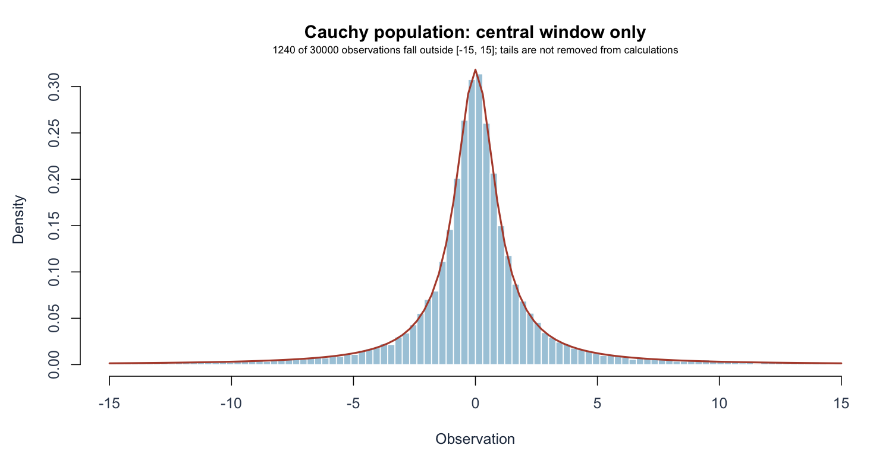
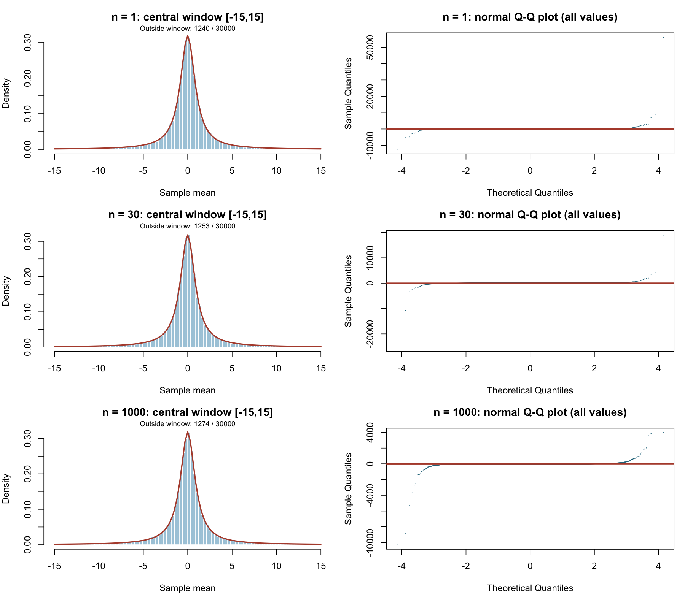
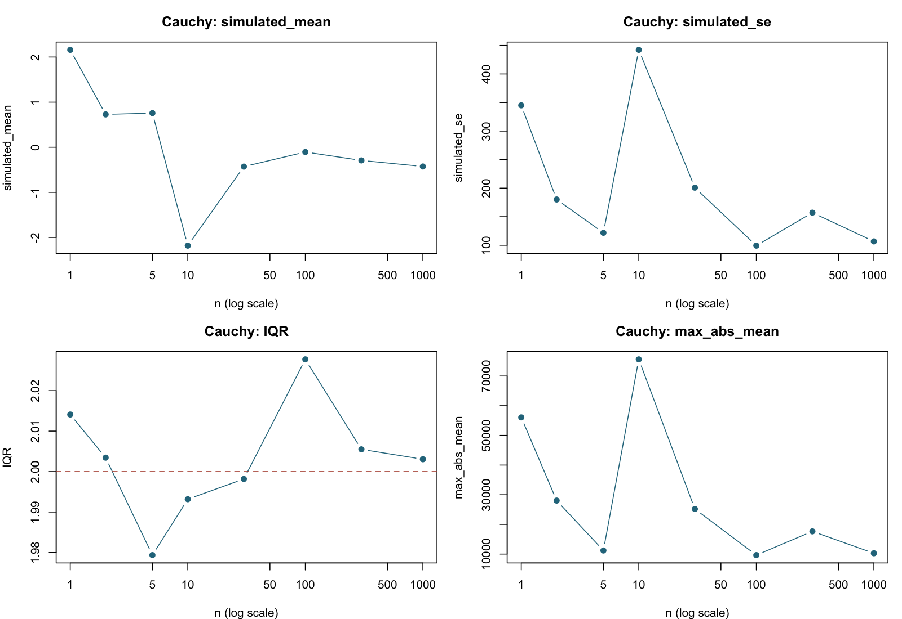

[Executive summary](../index.html) · [Full R implementation](../R/simulation.R)

```{r}
#| include: false
source("R/report_helpers.R")
key <- "cauchy"
result <- result_for(key)
if (!is.na(result$chosen)) {
  chosen <- row_at(result, result$chosen)
  previous <- row_at(result, max(1, result$chosen-1))
}
```

## Population, theory, and prediction

Observations are independent standard Cauchy draws, with location 0 and scale 1. The density is symmetric and extremely heavy-tailed. **Location 0 is not a population mean, and scale 1 is not a standard deviation.** The mean is undefined and there is no finite variance, so $\sigma/\sqrt n$ is not an available standard error.

The pre-simulation prediction is no normal convergence of the sample mean, regardless of n. This can be established analytically: the standard Cauchy characteristic function is $\phi_X(t)=e^{-|t|}$. Independence gives

$$
\phi_{\bar X}(t)=\{\phi_X(t/n)\}^{n}
=\{e^{-|t|/n}\}^{n}=e^{-|t|}.
$$

Thus the average is itself standard Cauchy for every n. Its median remains 0 and its interquartile range remains 2. Increasing n does not concentrate the sampling distribution.

## Original population





## Results and graphical evidence

The actual sample sizes tested were:

```{r}
#| echo: false
cat(paste(result$diagnostics$n, collapse = ", "))
```

```{r}
#| echo: false
#| results: asis
decision_table(result)
```

The table shows the decision neighborhood and comparison sizes; the full numerical record is in `results/cauchy.csv`.





## Conclusion and limitations

**No sample size is selected.** Testing through n=1000 supplies numerical evidence, but the claim about all n comes from the stability argument above, not from extrapolating a finite simulation.

At n=1 the empirical IQR is `r fmt(row_at(result,1)$IQR)`, and at n=1000 it is `r fmt(row_at(result,1000)$IQR)`, both near 2. The reported finite-run average at n=1000 is `r fmt(row_at(result,1000)$simulated_mean)` and the finite-run SD is `r fmt(row_at(result,1000)$simulated_se)`. These computed numbers do **not** estimate an existing population mean or finite theoretical SE.

The histograms show only the central interval [-15,15] so the center is readable. Every panel states how many observations lie outside that window; none are removed from the calculations. The red histogram curve is the **standard Cauchy density**, not a normal density. Full Q–Q plots retain all means, revealing extreme departures from a normal line.

The apparent bell-like symmetry of the center can be misleading. Meanwhile, the empirical SD sometimes falls as n rises and then rises again; that is not evidence of $1/\sqrt n$ scaling. Rare extremes dominate it. The CSV retains empirical skewness and excess kurtosis for audit, but these unstable finite-run quantities are not estimates of finite Cauchy population moments and are not used to judge convergence.

This example violates the finite-variance assumption of the ordinary iid CLT while preserving independence and identical distribution. A larger n cannot repair that missing assumption.

## Reproduction

Run `Rscript run_simulations.R` and `Rscript validate.R` from the project root, then `quarto render`. Software versions are recorded in `results/session-info.txt`.
